

  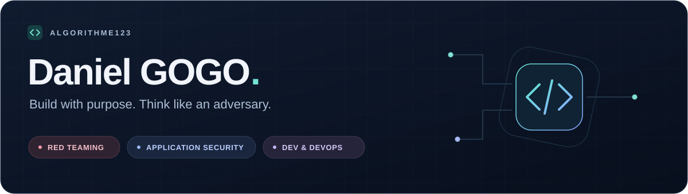

  <strong>Red Teamer · Full-Stack Developer</strong> 
  Build with purpose. Think like an adversary.

  <a href="https://www.linkedin.com/in/daniel-gogo-iit/">LinkedIn</a>
  &nbsp;·&nbsp;
  <a href="https://algorithme123.github.io/danielgogo/">Portfolio</a>
  &nbsp;·&nbsp;
  <a href="https://github.com/Algorithme123/zerodayctf2026">CTF write-ups</a>

## About

I work at the intersection of **offensive security** and **software development**. I enjoy understanding attack paths, testing security assumptions, and building more resilient applications.

I value clear reporting, useful tests, and repeatable deployments.

**Focus:** Red teaming · Web & API security · CTFs · Secure development

## Languages & Web

  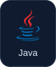
  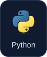
  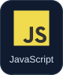
  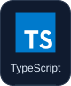
  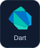
  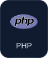
  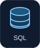
  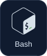
  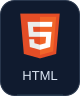
  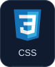

## Frameworks

  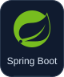
  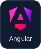
  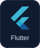
  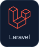
  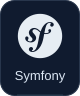
  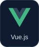
  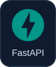
  

